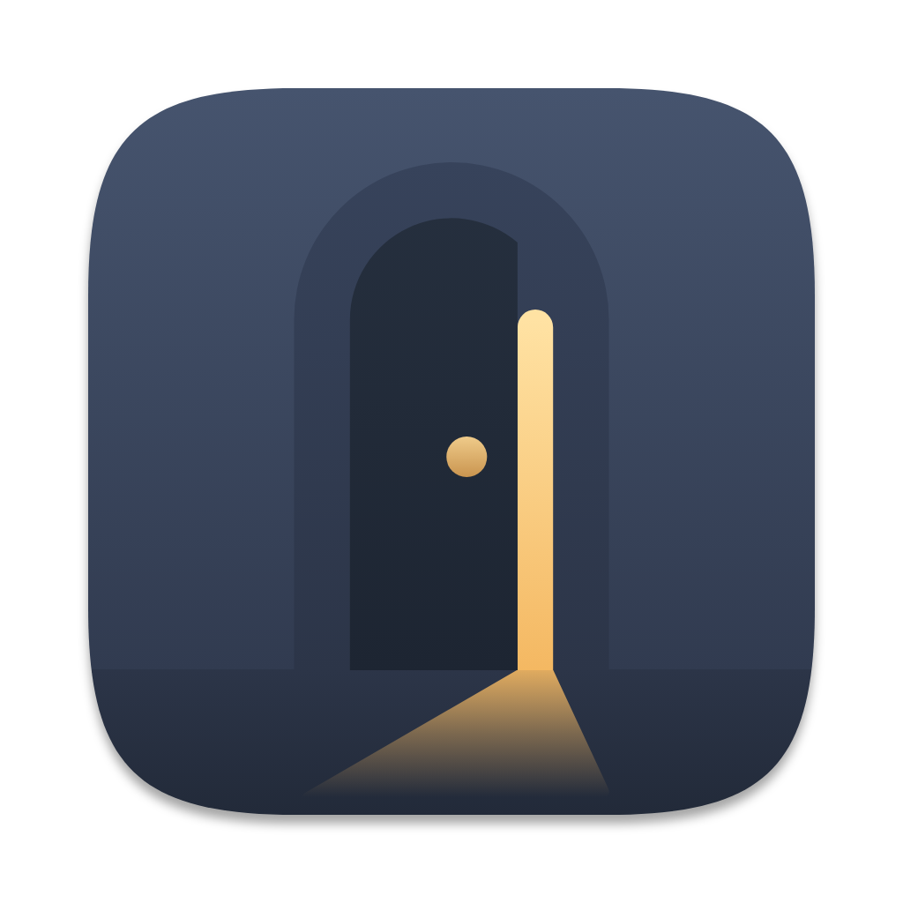

# Spanreed logo: Door Ajar

An arched door left ajar at home. The sliver of warm light at its latch edge is also the text cursor: someone is
home, and the note is open. The brief was quiet, simple, comfortable and homely, and native to macOS.

## Where things are

| Path | What |
|---|---|
| `Sources/Spanreed/Assets.xcassets/AppIcon.appiconset/` | The icon the app ships: 10 PNGs, 16–1024 px. 16 and 32 px use a separate small-size drawing. |
| `app-icon/` | Icon artwork (`AppIcon-1024.svg`, `AppIcon-small.svg`, `AppIcon-1024.png`) and `icon-composer/` layers for a macOS 26 `.icon`. |
| `masters/` | SVG logo masters: symbol (black, reversed, colour, colour-dark, small cut), horizontal and stacked lockups, wordmark, app-icon lockup. Also `palette.md` / `palette.json` and `lockup-spec.md`. |
| `exports/` | PNG renders of the masters, favicons and web icons. |
| `guidelines/` | Usage guide: `guidelines.png` (one page), `guidelines.html` (printable), `guidelines.md`. |
| `wordmark/` | The "Spanreed" wordmark outline, its spec and the font licence. |
| `mockups/macos-contexts.png` | The icon in a Dock, Finder list, About window, Launchpad grid and notification. |

## Which file to use

- **Light backgrounds:** `masters/spanreed-door-ajar-horizontal-color.svg` (or `-stacked-color.svg`).
- **Dark backgrounds:** `masters/spanreed-door-ajar-horizontal-white.svg`.
- **Symbol below 32 px:** `masters/spanreed-door-ajar-symbol-small*.svg`. The regular symbol's light gap closes at 16 px.
- **One colour:** the black or white files.

Clear space, minimum sizes and don'ts are in `guidelines/guidelines.png`.

## Colour and type

| Colour | Hex | Use |
|---|---|---|
| Dusk | `#46546E` | Icon wall, primary brand colour |
| Dusk Deep | `#2C3548` | Flat dark ground |
| Ink | `#26303F` | Door, wordmark, type |
| Warm Light | `#FFE2A3` | The light (on dark) |
| Amber | `#F0A94B` | The light and knob (on light) |
| Paper | `#F7F2E8` | Light ground |

Full table with RGB, CMYK and approximate Pantone: `masters/palette.md`.

The wordmark is Newsreader (weight 450, optical size 36), kerned by hand and converted to outlines, so no font is
needed to use it. Newsreader is under the SIL Open Font License 1.1 (`wordmark/OFL-Newsreader.txt`).

## Source files

The build scripts, review evidence and earlier explorations (including the unchosen Lamplight direction) stay in
the design workshop outside this repo, in Dropbox at `ai/logo-design/spanreed/opsu55-remixed/kit/`. The scripts
are in `door-ajar/src/`; the shared palette and wordmark builds are in `shared/`. Paths in the spec documents that
start with `kit/`, `../src/` or `../tests/` refer to that workshop.

## Not verified

- The macOS 26 `.icon` has not been built in Icon Composer. macOS 26 shows the legacy icon with its own glass edge.
- Pantone matches are approximate, and nothing has been test-printed.
- No trademark search has been done for the name or the mark.
