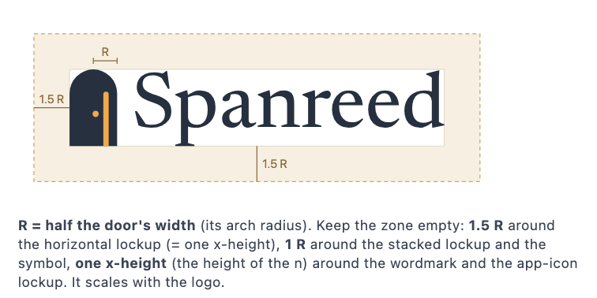
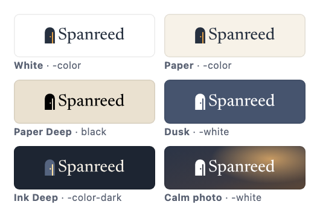
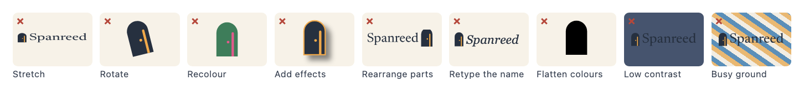

# Spanreed — Logo Guidelines (Door Ajar, compact)

> One page for everyone who uses the Spanreed logo. The same content, laid out, is `guidelines.html` / `guidelines.png`. Every number here is measured from the artwork; see `measurements.json`.

## 1. The logo

- **Idea**: an arched door left ajar at home. The sliver of warm light at its latch edge is also the text cursor: someone is home, and the note is open.
- **Versions**: primary **horizontal** · **stacked** · **symbol** (with a small cut for 16–32 px in every colourway, a favicon cut and a favicon tile) · **wordmark** · **app icon** (the main surface on the Mac) · **app-icon lockup** (README and site headers).
- **Colour files**: `-color` (Ink door, Amber light) for light grounds · `-color-dark` (Dusk Light door, Warm Light caret and knob, Paper word: the light stays the brightest part) for Ink Deep and near-black · black (one colour) · `-white` / `-reversed` (white, slightly thinned so it doesn't look heavier on dark; the square small cut `-symbol-small-reversed` is not thinned, because it is drawn on the 16 px grid).
- **Files**: `masters/*.svg` are the source for screens and print. `exports/` has PNGs, favicons and web icons. `app-icon/` has the macOS icon set. RGB for screens; for print the printer converts the SVG with their CMYK profile (see 4).

## 2. Clear space

Keep a clear zone around the logo, measured in **R = half the door's width** (the radius of its arch). The zone scales with the logo; never use a fixed distance.

| Version | Clear space | In the master's units |
|---|---|---|
| Horizontal (and small cut) | **1.5 R** on every side (= one x-height) | R = 60.52, 1.5 R = 90.78 (x-height 91.07) |
| Stacked | **1 R** | R = 109.8 |
| Symbol | **1 R** | R = 62.0 |
| Wordmark alone | **one x-height** (the height of the n) | 91.07 |
| App-icon lockup | **one x-height** | 91.07 (= 0.277 × the tile) |

## 3. Minimum size

| Version | Screen | Print | Smaller than that, use |
|---|---|---|---|
| Horizontal | 32 px tall (139 px wide) | 26 mm wide | horizontal small cut |
| Horizontal, small cut (`-horizontal-small`) | 14–32 px tall (61–140 px wide) | 21 mm wide | symbol |
| Stacked | 48 px tall (61 px wide) | 14 mm tall (17.9 mm wide) | horizontal |
| Symbol-only (`-symbol-only`) | 32 px tall | 6 mm tall | symbol small cut |
| Symbol, square (`-symbol`, `-symbol-reversed`, `-symbol-color*`) | 32 px | 7 mm square | symbol small cut |
| Symbol, small cut (`-symbol-small`; on dark grounds `-symbol-small-reversed` or `-symbol-small-color-dark`; colour `-symbol-small-color`) | 16–32 px | door 3 mm tall | — |
| Favicon cut (`-symbol-favicon`, `exports/symbol/favicon.svg`) and favicon tile (`-favicon-tile`, `exports/symbol/favicon.ico`, `favicon-16/32/48.png`) | exactly 16, 32 or 48 px (vertical edges and floor on the pixel grid) | screen only | — |
| Wordmark | cap height 8 px: ink 46 px wide (file 48 × 13 px) | cap height 2.8 mm: ink 16.1 mm wide (file 16.8 × 4.6 mm) | — |
| App icon | 16 px; the iconset uses its own small cut at 16–32 px | tile 8 mm | symbol |
| App-icon lockup | 72 px tall (242 px wide) | 27 mm wide | horizontal |

- **`-color-dark` files** (Dusk Light door, Warm Light caret and knob, 4.74 : 1 inside the door) go on Ink Deep (2.58 : 1 for the door) or near-black, at the same minimum sizes as the black files; below 32 px use `-symbol-small-color-dark`. On Dusk and Dusk Deep the door is too weak (2.06 : 1 on Dusk Deep): use `-white` there.
- **How the print sizes were set**: the light gap (caret) stays at least 0.35 mm wide and the letters' thinnest hairlines (the e's crossbar, 7.4 units at font size 200) at least 0.15 mm, rounded up to a whole millimetre. The wordmark alone uses the family figure from `design/logo/wordmark/wordmark-spec.json` (the same 0.15 mm rule on the outline, cap height rounded up to 0.1 mm), so the Lamplight guide gives the same print minimum. Test-print anything near the limit.

## 4. Colour

| Name | HEX | RGB | CMYK | Pantone (approx.) | Use |
|---|---|---|---|---|---|
| Dusk | `#46546E` | 70 84 110 | 36 24 0 57 | 7545 C (ΔE 7.1) † | Primary · icon wall |
| Dusk Deep | `#2C3548` | 44 53 72 | 39 26 0 72 | 533 C (ΔE 4.7) | Flat dark ground |
| Ink | `#26303F` | 38 48 63 | 40 24 0 75 | 7546 C (ΔE 4.0) | Door · wordmark · type |
| Ink Deep | `#1D2532` | 29 37 50 | 42 26 0 80 | 7547 C (ΔE 3.2) | Ground for -color-dark |
| Warm Light | `#FFE2A3` | 255 226 163 | 0 11 36 0 | 7401 C (ΔE 2.7) | Light + knob (-color-dark) |
| Warm Light Deep | `#F4B862` | 244 184 98 | 0 25 60 4 | 1365 C (ΔE 3.6) | Icon light, bottom |
| Paper | `#F7F2E8` | 247 242 232 | 0 2 6 3 | Cool Gray 1 C (ΔE 6.6) † | Light ground |
| Paper Deep | `#EAE1D0` | 234 225 208 | 0 4 11 8 | 7527 C (ΔE 4.3) | Cards · stock tint |
| Amber | `#F0A94B` | 240 169 75 | 0 30 69 6 | 7410 C (ΔE 3.5) | Light + knob (-color) |
| Slate | `#2F3644` | 47 54 68 | 31 21 0 73 | 7546 C (ΔE 4.6) | Neutral, not in the logo |
| Dusk Light | `#55647F` | 85 100 127 | 33 21 0 50 | 431 C (ΔE 8.1) † | Door Ajar only · dark door |

The first ten rows are the shared family, in the same order and with the same numbers as the Lamplight guide (source: the shared palette script in the design workshop, see `design/logo/README.md`). Dusk Light is Door Ajar's own colour; Lamplight does not use it. CMYK is a plain conversion with no colour profile. For print, convert from sRGB with the printer's profile and proof. The Pantone column is the nearest hit in the brand's shared table of approximate values (kept in the design workshop, see `design/logo/README.md`); † = no close solid, ΔE00 > 6 (Dusk 7.1, Paper 6.6, Dusk Light 8.1). Check every one against a physical swatch book. Full numbers: `masters/palette.md`.

**Approved logo/background pairs**

| Ground | File | Contrast |
|---|---|---|
| White, Paper `#F7F2E8`, light grey | `-color` | Ink on white 13.32 : 1, on Paper 11.93 : 1 |
| Paper Deep, light stock, one-colour print | black | — |
| Dusk `#46546E`, Dusk Deep `#2C3548` (the flat dark brand ground) | `-white` | white on Dusk 7.63 : 1 |
| Ink Deep `#1D2532` (darkest ground, dark mode), near-black | `-color-dark` or `-white` | Dusk Light door on Ink Deep 2.58 : 1, Warm Light in the door 4.74 : 1, Paper word 13.81 : 1 |
| Photos | `-white` (or black) on a calm part of the image; on a busy image, the app icon as a container | — |

Not approved: Ink artwork on Dusk (1.75 : 1) or on black; `-color-dark` on Dusk or Dusk Deep (the door disappears); the app-icon lockup on Dusk (the tile edge disappears); Amber as text on white or Paper (2.0 : 1).

## 5. Typography

- **Wordmark**: Newsreader, weight 450, optical size 36, hand-kerned, outlined, overlaps removed. Always use the file; never type the name in a font (the instance is not a named style and the spacing is custom).
- **Headlines and long text**: Newsreader, weight 400–500, optical size matched to the size (on the web, `font-optical-sizing: auto`).
- **Interface, labels, captions**: the system font, `system-ui, -apple-system, "Segoe UI", sans-serif` (SF Pro on a Mac). Note text and file names: `ui-monospace, "SF Mono", Menlo, monospace`.
- **Licences**: Newsreader is SIL Open Font License 1.1 (free for print, web and apps; the licence travels with the font: `design/logo/wordmark/OFL-Newsreader.txt`). System fonts are used through the system and never embedded or redistributed.

## 6. Don'ts

Don't stretch or squash · don't rotate · don't recolour outside the palette · don't add shadows, outlines, gradients or effects · don't rearrange or resize the parts of a lockup · don't retype the wordmark · don't flatten a colour file to one colour (the light and knob merge into the door; use the black or white file) · don't place it on low-contrast grounds (Ink on Dusk) · don't place it on busy backgrounds without a container.

## 7. Contact

Questions about usage: the Spanreed project owner, Mike Magarino. Master files: `design/logo/` (`masters/`, `exports/`, `app-icon/`); the Mac app icon: `Sources/Spanreed/Assets.xcassets`. Rationale and open items: `design/logo/README.md`.
